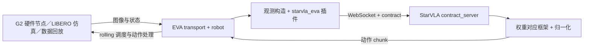

# EVA × StarVLA 部署与迁移

版本：`eva-deploy-20261013`。服务器使用本仓库，机器人端使用随仓库提供的 EVA 和桥接扩展。

## 1. 目录与职责

| 路径 | 部署位置 | 内容 |
| --- | --- | --- |
| `EVA-CLIENT/` | 机器人端／仿真端 | 用户提供的 EVA 源码、配置、机器人模型资产、硬件节点、许可证 |
| `examples/realRobots/EvaClient/` | 两端 | contract、EVA 插件、StarVLA 服务入口、回放与仿真评估 |
| `examples/realRobots/AgiBotG2/` | 模型服务器 | G2 数据注册、固定关节归一化、100/9 训练验证划分、训练配方 |
| `starVLA/model/` | 模型服务器 | 权重所用的框架、VLM 和动作头；包含独立 pure rolling-flow |
| `deployment/model_server/` | 模型服务器 | 原有模型加载、归一化和 WebSocket 服务实现 |



`run_eva.py` 先注册外部插件，再启动 EVA 原有应用。EVA 源码保持提供的版本；插件集中在 `eva_extension/`。更换本体时配置已有的 EVA robot/transport；更换算法时使用实现了 StarVLA `predict_action` 接口的框架和对应训练权重。相机、状态、动作语义与维度通过 contract 明确匹配。

本版本实际验证了 G2 数据回放和 LIBERO 仿真闭环。新本体或不同输入形式仍需要对应 adapter/contract；当前服务一次接收一条观测，只接一个机器人连接。

## 2. 全新机器需要准备什么

模型服务器检出本版本的完整仓库，按 [StarVLA 安装说明](../README.md) 建好模型环境。机器人端可以复制相同仓库，也可以使用第 6 节的客户端 ZIP。

两端使用不同 Python 环境：EVA 提供的 `pyproject.toml` 要求 Python 3.11；此次模型环境使用 Python 3.10。EVA 端只请求策略服务器，模型和 CUDA 放在服务器端。

权重、基础 Qwen 模型和录制数据单独传输。StarVLA 加载权重时需要以下布局，不能只复制 `.pt` 文件：

```text
MODEL_RUN/
├── config.yaml
├── dataset_statistics.json
├── final_model/pytorch_model.pt           # G2 30K
└── checkpoints/steps_55000_pytorch_model.pt # LIBERO 55K，使用对应 run
```

`config.yaml` 中的 `framework.qwenvl.base_vlm` 要指向新机器上的对应 Qwen 模型。保留训练所得 `dataset_statistics.json` 和模型参数设置。G2 服务还依赖本版本的 G2 registry 与 `AGIBOT_G2` 本体注册。

迁移到已有 EVA 仓库时，将其放在仓库根目录的 `EVA-CLIENT/`。若通过 `--eva-root` 指定其他路径，还需调整配置的 `_base_`：配置继承路径与启动参数分别解析。建议先使用本版本随附的 EVA 源码，因为任意更新版 EVA 的接口兼容性尚未验证。

## 3. G2 真机部署

### 策略服务器

在仓库根目录设置本机 Python 和权重路径：

```bash
export STARVLA_MODEL_PYTHON=/path/to/starvla-env/bin/python
export G2_CHECKPOINT=/path/to/MODEL_RUN/final_model/pytorch_model.pt

CUDA_VISIBLE_DEVICES=0 "$STARVLA_MODEL_PYTHON" \
  -m examples.realRobots.EvaClient.contract_server \
  --checkpoint "$G2_CHECKPOINT" \
  --contract examples/realRobots/EvaClient/contracts/agibot_g2_rollflow_h64_c16.json \
  --device cuda:0 --host 0.0.0.0 --port 10094
```

当前 G2 权重是纯瞬时速度 Flow Matching＋Rolling：H=64、4 次迭代、每次执行 16 步。raw state 和反归一化动作均为 24D qpos，顺序为左臂 7、左夹爪 1、右臂 7、右夹爪 1、头 3、腰身 5。服务端复用训练归一化；EVA 对夹爪使用 G2 的开闭处理。

### EVA 和 G2 硬件节点

EVA 完整应用及 UI 环境安装在机器人端：

```bash
uv sync --project EVA-CLIENT --python 3.11
```

G2 硬件节点使用独立 GDK 环境，沿用 [EVA G2 说明](../EVA-CLIENT/examples/hardware/agibot_g2/README.md)。安装本地 GDK 的入口：

```bash
AGIBOT_GDK_LOCAL_PATH=/path/to/agibot-gdk \
  bash EVA-CLIENT/examples/hardware/agibot_g2/setup_env.sh

PYTHONPATH="$PWD/EVA-CLIENT/src" \
  EVA-CLIENT/examples/hardware/agibot_g2/.venv/bin/python \
  EVA-CLIENT/examples/hardware/agibot_g2/node.py
```

硬件节点默认绑定本机 `5555` 观测端口、`5556` 动作端口，适用于 EVA 与硬件节点同机。分机部署时用节点的 `--obs-endpoint / --action-endpoint` 改绑定地址，并在 EVA 配置对应连接地址。

另一个终端从包／仓库根目录启动 EVA：

```bash
export STARVLA_HOST=MODEL_SERVER_IP
export STARVLA_PORT=10094
export G2_OBS_ENDPOINT=tcp://127.0.0.1:5555
export G2_ACTION_ENDPOINT=tcp://127.0.0.1:5556

EVA-CLIENT/.venv/bin/python -m examples.realRobots.EvaClient.run_eva \
  --config examples/realRobots/EvaClient/configs/agibot_g2_live.py \
  --web-port 8080
```

配置中的任务文本是本次训练任务：“Pick up the white carton and place it inside the large tan carton on the left.” G2 三相机按 `top_head / hand_left / hand_right` 排列，BGR→RGB 一次、Pillow 默认 bicubic 直接缩放至 224×224。状态原样发送，由服务端处理。`StarVlaRollingStrategy` 完整执行 16 步后请求新观测，连接与回合开始时重置缓存。

## 4. 用 G2 保留数据检查输入和动作

在已安装 EVA 数据回放依赖的 Python 3.11 环境运行，G2 策略服务器保持运行：

```bash
export EVA_PYTHON="$PWD/EVA-CLIENT/.venv/bin/python"
export STARVLA_HOST=MODEL_SERVER_IP
export STARVLA_PORT=10094
export STARVLA_G2_DATASET=/path/to/white_carton_to_left_tan_carton_20261009

"$EVA_PYTHON" -m examples.realRobots.EvaClient.evaluate_dataset_via_eva \
  --dataset "$STARVLA_G2_DATASET" \
  --episodes 0,13,27,40,54,67,81,94,108 \
  --output work_dirs/eva_validation/g2_replay.json
```

回放通过 EVA DatasetTransport、观测构造、策略请求和动作处理，与记录动作比较，不发布动作。它能检查拟合及数据链路，不能代替 G2 真机反馈与任务成功率。数据准备与训练见 [AgiBotG2](../examples/realRobots/AgiBotG2/README.md)。

## 5. LIBERO 仿真检查整条闭环

使用具有完整 assets 和 init_files 的标准 LIBERO checkout。下列 helper 安装独立 Python 3.11 CPU 仿真环境；系统需已有 OSMesa 渲染依赖。此环境用于 headless 联合评估，EVA 完整 UI 使用第 3 节的环境。

```bash
export EVA_EVAL_ENV=/path/to/eva-eval-env
export LIBERO_CHECKOUT=/path/to/LIBERO
bash examples/realRobots/EvaClient/setup_eval_environment.sh \
  "$EVA_EVAL_ENV" "$LIBERO_CHECKOUT"
```

模型服务器另开端口。所用 LIBERO 权重是包含自蒸馏的历史 RollFlow，H32/C8/K4；它的历史 Goal suite 成功率为 448/500，详见验证记录。

```bash
export LIBERO_CHECKPOINT=/path/to/LIBERO_MODEL_RUN/checkpoints/steps_55000_pytorch_model.pt
"$STARVLA_MODEL_PYTHON" -m examples.realRobots.EvaClient.contract_server \
  --checkpoint "$LIBERO_CHECKPOINT" \
  --contract examples/realRobots/EvaClient/contracts/libero_rollflow_h32_c8_k4.json \
  --device cuda:0 --port 10093
```

仿真端运行两个任务，并保存视频：

```bash
export STARVLA_HOST=MODEL_SERVER_IP
export STARVLA_PORT=10093
export PYTHONPATH="$LIBERO_CHECKOUT"
export LIBERO_CONFIG_PATH="$EVA_EVAL_ENV/libero-config"
export MUJOCO_GL=osmesa PYOPENGL_PLATFORM=osmesa
export TORCH_FORCE_NO_WEIGHTS_ONLY_LOAD=1
export OMP_NUM_THREADS=2 OPENBLAS_NUM_THREADS=2

"$EVA_EVAL_ENV/bin/python" -m examples.realRobots.EvaClient.evaluate_libero_via_eva \
  --config examples/realRobots/EvaClient/configs/libero_sim_verified.py \
  --suite libero_goal --task-ids 0,1 --episodes-per-task 2 --policy-seed 7 \
  --output work_dirs/eva_validation/libero_rollout.json \
  --video-dir work_dirs/eva_validation/videos
```

LIBERO 每次执行 8 个动作，下一观测来自动作后的仿真状态。7D 输出是 Cartesian delta，使用 LIBERO 的夹爪转换；它的 contract 中 `mode=joint` 表示 EVA 透传向量，不表示真实关节角。

原生接口核对命令及代码在 [EvaClient README](../examples/realRobots/EvaClient/README.md)。核对两边共用策略服务器，验证 EVA 图像适配、chunk 调度和夹爪处理。

## 6. 打包机器人端

在含本版本提交的仓库运行：

```bash
bash scripts/package_eva_deployment.sh eva-deploy-20261013
```

输出 `dist/eva-starvla-client-<commit>.zip`。它从指定 Git 提交导出 EVA、桥接插件、contract、部署说明和验证记录；不会把本机环境与未提交改动混入包。解压后保持 `EVA-CLIENT/` 与 `examples/realRobots/EvaClient/` 的相对布局，从解压目录执行模块命令。

客户端包用于 EVA 执行端。策略服务器仍使用完整本仓库及训练所得权重、配置、归一化统计。源 ZIP、模型权重、录制数据、Python 环境和另行提供的 GDK 不在部署包内。

## 7. 版本依据

已有结果：[验证报告](../examples/realRobots/EvaClient/validation_report_20261013.md)；EVA 来源：[source.json](../examples/realRobots/EvaClient/eva_source.json)；本次整理范围：[版本说明](releases/eva-deploy-20261013.md)。

G2 九条回放得到 MSE 0.002755、RMSE 0.05249；LIBERO 两个任务共 4 次闭环执行成功 3 次。38 个 chunk 的原生接口核对中，图像、原始动作和处理后动作差异为 0。它们是 2026-10-13 工作区的既有验证记录，本次打包整理没有重新运行 GPU 推理或完整 benchmark。
