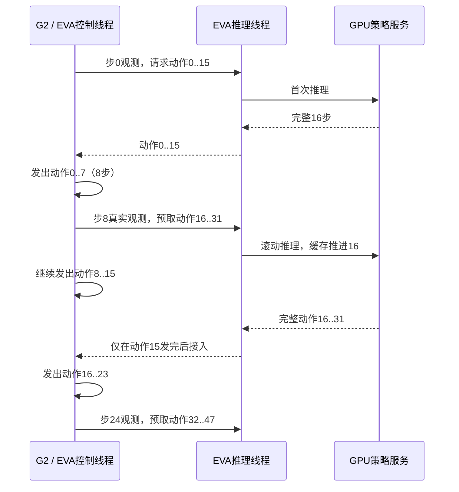

# G2 异步部署交接

## 1. 当前默认行为

模型仍是 30K 纯瞬时速度 Flow Matching + Rolling：H64、4 个16步时间块、K4、每次返回可执行16步。首次请求采用模型配置的迭代冷启动；后续使用模型的滚动缓存。部署不修改模型内部推理次数或时间阶梯。

默认 `configs/agibot_g2_live.py` 使用 `agibot_g2_rollflow_h64_c16_async.json`：



这里“发出8步”是8条命令成功交给EVA transport，并非8条硬件执行确认。G2原生协议没有执行ACK；低层按100Hz伺服，EVA按30Hz目标更新关节位置。真实到位需通过反馈核对。

**两种对齐需要分开检查：** 动作索引与模型缓存仍每次推进16步，没有丢掉后8步。下一段用第8步时的观测提前规划，不是第16步观测；相对同步推理有8步观测提前量。这不是严格相同的训练条件，也不是延迟补偿训练。不要伪造未来状态或把旧状态标记成未来观测。固定回放评估这种差别，真机trace记录实际反馈。

图像读取、ZMQ socket、仿真render/step、动作发布全部在控制线程；推理线程只做WebSocket请求和已有动作后处理。观测进入线程前复制。最多有一个在途请求、一段当前动作、一段预取动作。

## 2. 可选模式

| EVA配置 | 服务器契约 | 行为 | 30Hz理论推理余量 |
| --- | --- | --- | --- |
| `agibot_g2_live.py`（默认） | `agibot_g2_rollflow_h64_c16_async.json` | 第8步预取，执行完16步再接 | 8/30 ≈267ms |
| `agibot_g2_live_async4.py` | `agibot_g2_rollflow_h64_c16_async4.json` | 第4步预取，执行完16步再接 | 12/30 =400ms |
| `agibot_g2_live_sync.py` | `agibot_g2_rollflow_h64_c16.json` | 16步发完后读取观测、推理 | 边界等待一次推理 |

切换配置时两端一起换契约并重连；hash不一致直接拒绝。8/4不是执行horizon，不要将 `execute_horizon` 改成8或4，也不要使用前缀裁切/丢掉迟到动作。缓存推进量和阶梯时间块均为16。

### 时间集成

当前rolling返回的可执行范围是0..15、16..31，彼此不重叠，默认 `aggregation="none"`。把两段不同时间的动作平均会改变轨迹含义，特别是夹爪开闭。此策略拒绝ACT等聚合配置。

EVA原生另有异步buffer、插值和ACT等模式，面向有重叠预测的算法；当前外部rolling调度没有启用它们。要支持此类模式，需要一个无滚动缓存、可声明预测绝对时间范围的配方，并单独验证。平滑关节目标不等于时间集成，不在当前默认配方中增加。

### 推理赶不上时

- 当前完整16步继续发出；下一段没就绪时不发新命令，段边界等待。低层可能保持最后位置目标。
- 无跳步、无重复补发、无无限推理重试。计数只在transport实际发出命令后推进。
- G2请求超时5秒、冷启动允许5秒、后续滚动返回延迟超过1秒会关闭流；观察输入超过0.5秒没有接收/时间戳进展即拒发。
- 网络或推理错误会在控制循环报错，不能自动回落到同步模式继续推进缓存。停止后重连、重置，再从新回合开始。
- 默认8步不能承诺无停顿：本机同步G2实测RPC中位数约327ms，超过267ms；应按异步报告及实际真机日志选择4或8。4步观测更早，可能影响拟合，需同时比较。

## 3. 模型机 / GPU

从完整StarVLA仓库根目录执行：

```bash
export STARVLA_MODEL_PYTHON=/path/to/starvla-env/bin/python
export G2_CHECKPOINT=/path/to/MODEL_RUN/final_model/pytorch_model.pt
CUDA_VISIBLE_DEVICES=0 "$STARVLA_MODEL_PYTHON" -m examples.deployment.eva server \
  --checkpoint "$G2_CHECKPOINT" \
  --contract examples/deployment/eva/contracts/agibot_g2_rollflow_h64_c16_async.json \
  --host 0.0.0.0 --port 10094 --device cuda:0
```

权重旁保留训练 `config.yaml`、`dataset_statistics.json`，基础Qwen模型路径在该机有效。服务启动核对H64/C16/K4、框架、相机顺序与训练变换。CPU客户端不加载权重或CUDA。

## 4. 机器人侧 / CPU

复制部署模块与EVA checkout，保持 `examples/deployment/eva` 的包布局，安装EVA的Python3.11依赖。两个项目可独立更新；部署模块两端使用同一版本与契约。

```bash
export EVA_CHECKOUT=/path/to/EVA-CLIENT
export EVA_PYTHON=/path/to/eva-env/bin/python
export G2_HARDWARE_PYTHON=/path/to/gdk-env/bin/python
export STARVLA_HOST=GPU_MACHINE_IP STARVLA_PORT=10094
export G2_OBS_ENDPOINT=tcp://127.0.0.1:5555
export G2_ACTION_ENDPOINT=tcp://127.0.0.1:5556
```

### 配置与空闲服务器握手

```bash
"$EVA_PYTHON" -m examples.deployment.eva doctor \
  --eva-root "$EVA_CHECKOUT" --config examples/deployment/eva/configs/agibot_g2_live.py \
  --host "$STARVLA_HOST" --port "$STARVLA_PORT" --output work_dirs/g2_doctor.json
```

doctor不请求动作，不连接硬件。单策略连接服务要求在EVA执行客户端连接前做握手诊断。升级任一项目后先跑CPU测试。

### 硬件节点

```bash
"$G2_HARDWARE_PYTHON" -m examples.deployment.eva hardware \
  --eva-root "$EVA_CHECKOUT" \
  --obs-endpoint tcp://127.0.0.1:5555 --action-endpoint tcp://127.0.0.1:5556
```

使用外部入口。它复用原生GDK、相机、状态与伺服代码，调整动作socket为SUB连接；EVA动作XPUB绑定5556。不要同时运行旧的直接绑定5556的节点。

EVA与硬件节点同机时使用127.0.0.1。若两者也分机：硬件观测PUB绑定 `tcp://0.0.0.0:5555`；EVA观测SUB连接硬件IP。EVA动作XPUB绑定 `tcp://0.0.0.0:5556`；硬件动作SUB连接EVA机器IP。模型服务IP只用于WebSocket。

### 先检查真实输入

```bash
"$EVA_PYTHON" -m examples.deployment.eva capture \
  --eva-root "$EVA_CHECKOUT" --obs-endpoint "$G2_OBS_ENDPOINT" \
  --count 3 --output work_dirs/g2_live_inputs.json
```

此命令仅订阅观测，无模型请求、无动作socket。JSON/NPZ保存三相机原始BGR、最终模型RGB、原始24维状态。需要与采集数据核对相机安装/方向/顺序、关节单位、符号、内外夹爪对应、任务场景。Mock不能证明真实GDK读数已满足这些条件。

### 启动EVA

```bash
"$EVA_PYTHON" -m examples.deployment.eva client \
  --eva-root "$EVA_CHECKOUT" --config examples/deployment/eva/configs/agibot_g2_live.py \
  --trace-dir work_dirs/g2_live_trace --web-port 8080
```

使用训练任务文本。默认初始姿态来自100条训练轨迹首帧的逐关节中位数，定义在contract的 `eva.initial_qpos`；不是EVA通用G2展示姿态。它用于原生初始化流程，不证明当前位置到该姿态的运动路径适合现场。不要将另一任务/坐标定义的姿态直接套用。

Setup可能进行验证推理，但丢弃结果后同时重置缓存；warmup不额外推进滚动缓存。RUN首次正常推理后启动执行。暂停、任务切换、重连都应结束旧回合并清理预取结果；不要从已部分执行的chunk中间直接续跑。

### 查看时序

`execution.jsonl`包含：

- `prefetch_requested`：观测步、下一段动作起点、源观测时间。
- `chunk_ready`：实际接入的段与完整后处理动作。
- `command_issued`：序号、段内0..15索引、已发目标、当时反馈、夹爪覆盖差异。
- `async_wait_start/end`：冷启动或段边界等待时间。
- `chunk_reset`：中止前发出了几步。

正常请求观测步为0、8、24、40……；段起点为0、16、32、48……。每完整段已发索引必须连续0..15。首次等待是冷启动；统计后续等待判断8步推理余量是否够。

模型输入/原始预测trace默认最多32请求，执行trace最多10000事件。日志I/O失败不重发已发出的动作。订阅就绪只证明动作SUB存在，不能替代GDK执行ACK。

## 5. 部署前回归命令

CPU测试仅本地模拟：

```bash
"$EVA_PYTHON" -m pytest examples/deployment/eva/tests -q
```

G2异步保留集使用30K服务和相应异步契约：

```bash
"$EVA_PYTHON" -m examples.deployment.eva async-replay \
  --eva-root "$EVA_CHECKOUT" --config examples/deployment/eva/configs/agibot_g2_live.py \
  --dataset /path/to/white_carton_to_left_tan_carton_20261009 \
  --host "$STARVLA_HOST" --port "$STARVLA_PORT" \
  --episodes 0,13,27,40,54,67,81,94,108 --output work_dirs/g2_async8.json
```

动作仅发向临时本地IPC和Mock GDK。JSON报告拟合MSE、实际收到/伺服请求数、预取时序、等待；NPZ保存逐关节轨迹。观测来自记录数据，没有真实机器人动力学。触发帧在执行前解码，为了在控制线程发布模拟图像，探针放宽观测新鲜度到30秒；生产客户端保持0.5秒，CPU测试覆盖故障分支。

LIBERO异步仿真使用55K自蒸馏权重、服务器契约 `libero_rollflow_h32_c8_k4_async.json` 和 `configs/libero_sim_async.py`（H32/C8、第4步预取）：

```bash
PYTHONPATH="$LIBERO_CHECKOUT" LIBERO_CONFIG_PATH="$LIBERO_CONFIG" \
MUJOCO_GL=osmesa PYOPENGL_PLATFORM=osmesa TORCH_FORCE_NO_WEIGHTS_ONLY_LOAD=1 \
"$EVA_PYTHON" -m examples.deployment.eva libero \
  --config examples/deployment/eva/configs/libero_sim_async.py \
  --suite libero_goal --task-ids 0,1 --episodes-per-task 2 --policy-seed 7 \
  --output work_dirs/libero_async.json --video-dir work_dirs/libero_async_videos
```

这验证动作改变仿真状态后的真实闭环。4次试验仅是小规模回归，不能据此宣称真机成功率或算法总体成功率。实测结果、限制及视频位置见 [验证报告](validation_report_20261014.md)。

### 目标30Hz下的推理余量测量

完整Mock GDK探针包含模拟图像编码、socket和伺服开销，因此不能用它的“没有边界等待”推断真机能达到30Hz。可另测只保留实际模型RPC和原生EVA调度、观测/输出驻留内存的时序：

```bash
"$EVA_PYTHON" -m examples.deployment.eva timing \
  --config examples/deployment/eva/configs/agibot_g2_live.py \
  --dataset /path/to/white_carton_to_left_tan_carton_20261009 \
  --host "$STARVLA_HOST" --port "$STARVLA_PORT" --actions 128 \
  --output work_dirs/g2_async8_timing.json
```

服务器需要对应异步契约。此命令不创建动作socket、不发真机命令，也不模拟动力学；用于测量RPC与调度能否覆盖267/400ms余量。完整链路和真实网络/底层开销仍需执行trace。
