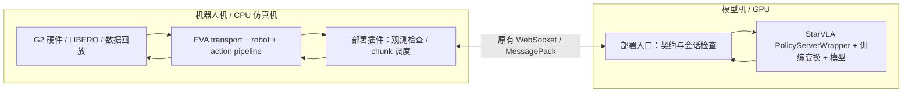

# EVA × StarVLA 部署集成与验证

此模块复用 EVA 的机器人、transport、观测构造和动作执行，以及 StarVLA 的模型加载、训练变换和 WebSocket 服务。它集中管理部署配置、数据契约、执行策略与回归测试。

迁移后的 [回归报告](validation_report_20261013.md)：CPU 42项通过，G2九条回放和LIBERO四条执行轨迹与既有记录逐元素相同，38个chunk的原生接口核对差异为0。

后续完整动作链路检查见 [2026-10-14 报告](validation_report_20261014.md)。G2 增加原生硬件代码 + Mock GDK + ZMQ + EVA 执行循环测试，并调整动作连接角色。真机部署使用下面的外部 `hardware` 入口。

## 两台机器，独立更新



- 机器人机装 EVA、该部署目录及依赖；不加载 StarVLA 模型或 CUDA。`--eva-root` 可指定独立 EVA checkout，无需改配置继承路径。
- 模型机装完整 StarVLA、该部署目录和训练所得权重目录；不需要导入 EVA。
- 两端共享同一份 `contracts/*.json`。V2 在原有消息 envelope 中增加契约 hash、会话及 chunk 序号。无需另开一个转发进程。
- `adapters/eva.py` 隔离 EVA 的配置、快照读取边界；`adapters/starvla.py` 隔离权重配置、归一化变换等版本相关访问。LIBERO 原生接口核对的特殊访问在 `adapters/reference.py`。

**不能承诺任意未来 API 自动兼容。** 升级后先运行 doctor 与 CPU 测试；若接口改变，只调整对应 adapter，再跑固定数据回放和仿真验证。源码指纹、依赖版本、契约和模型运行配置随报告记录。

## 目录

| 路径 | 职责 |
| --- | --- |
| `bridge_contract.py`、`contracts/` | 相机顺序、像素处理、状态切片、动作含义、单位与执行配置 |
| `runtime.py`、`configs/` | 从契约派生图像处理、控制频率、夹爪参数和执行策略 |
| `eva_extension/` | 外部注册 policy、transport、robot、strategy |
| `contract_server.py`、`protocol.py` | 复用 StarVLA 服务，检查训练配置、归一化、单连接滚动会话 |
| `doctor.py`、`tests/` | CPU 诊断和接口回归，不推理、不发送真机动作 |
| `evaluate_dataset_via_eva.py` | G2 保留数据回放，预测与记录动作对比 |
| `evaluate_libero_via_eva.py` | LIBERO 实际执行动作后的仿真闭环，可保存视频 |
| `verify_libero_reference.py` | 同一观测序列对比原生 LIBERO `ModelClient.step` |
| `legacy/` | 早期 G2 专用原型的兼容代码 |

旧的 `examples/realRobots/EvaClient` Python/配置入口转发到这里。其历史 V1 契约与 [已保存验证报告](../../realRobots/EvaClient/validation_report_20261013.md) 保留原样；新配置使用本目录的 V2 契约，两端应一起迁移。

## G2 现有配方

| 项目 | 配置 |
| --- | --- |
| 模型 | QwenGR00TRollingFlow，纯瞬时速度 Flow Matching + Rolling |
| 预测 horizon / 执行 chunk / 迭代 | 64 / 16 / 4 |
| 状态 / 动作 | 24D，左臂7、左夹爪1、右臂7、右夹爪1、头3、腰身5 |
| 相机 | top_head、hand_left、hand_right，按此顺序 |
| 图像 | 原始 BGR uint8 → RGB，bicubic 直接缩放至224×224，不填充 |
| 归一化 | 由服务端使用权重的训练变换；客户端发送原始状态，接收反归一化动作 |
| 执行 | 目标发布30Hz，第8步异步预取下一段，当前16步全部执行；回合切换重置缓存 |

G2契约中的 rad、绝对关节位置和关节名称来自当前数据/本体约定。尺寸检查不能独立证明硬件读数单位正确；更换底层驱动时应拿一帧真实观测与采集数据核对。

详细的默认8步预取、4步选项、等待处理、两机启动与真机联调见 [G2异步部署交接](G2_ASYNC_DEPLOYMENT.md)。

## 启动与诊断

从仓库／部署包根目录执行。部署详细命令见 [迁移指南](../../../docs/eva_deployment.md)。

模型机：

```bash
CUDA_VISIBLE_DEVICES=0 "$STARVLA_MODEL_PYTHON" -m examples.deployment.eva server \
  --checkpoint "$G2_CHECKPOINT" \
  --contract examples/deployment/eva/contracts/agibot_g2_rollflow_h64_c16_async.json \
  --device cuda:0 --host 0.0.0.0 --port 10094
```

机器人机先检查配置和空闲服务器握手：

```bash
"$EVA_PYTHON" -m examples.deployment.eva doctor \
  --config examples/deployment/eva/configs/agibot_g2_live.py \
  --eva-root "$EVA_CHECKOUT" --host "$STARVLA_HOST" --port 10094 \
  --output work_dirs/eva_validation/doctor.json
```

doctor 不发推理请求和动作。服务器只允许一个策略连接；握手诊断需在执行客户端连接前完成。

机器人端使用外部G2硬件入口，复用原生观测、GDK读取和伺服逻辑：

```bash
"$G2_HARDWARE_PYTHON" -m examples.deployment.eva hardware \
  --eva-root "$EVA_CHECKOUT" \
  --obs-endpoint tcp://127.0.0.1:5555 \
  --action-endpoint tcp://127.0.0.1:5556
```

硬件环境需已安装真实 `agibot_gdk` 和 EVA 依赖。观测由硬件PUB绑定5555、EVA SUB连接；动作由EVA XPUB绑定5556、硬件SUB连接。XPUB保持原动作字节格式，并允许客户端确认订阅端就绪。当前G2配方使用此角色约定；旧节点直接运行会在5556产生绑定冲突，应使用上述入口。

另一个终端配置观测／动作端口并启动EVA：

```bash
export STARVLA_HOST=MODEL_SERVER_IP STARVLA_PORT=10094
export G2_OBS_ENDPOINT=tcp://127.0.0.1:5555
export G2_ACTION_ENDPOINT=tcp://127.0.0.1:5556
"$EVA_PYTHON" -m examples.deployment.eva client \
  --eva-root "$EVA_CHECKOUT" \
  --config examples/deployment/eva/configs/agibot_g2_live.py \
  --trace-dir work_dirs/eva_validation/live_trace --web-port 8080
```

trace 默认最多32个请求，保存服务端输入像素、原始／归一化状态、EVA动作处理前的预测chunk及延迟。它会消耗少量磁盘和序列化时间，适用于联调；还应结合EVA执行日志和底层实测反馈分析。

同目录的 `execution.jsonl` 最多保存10000条事件，包含处理后chunk、每条已发命令、回合/序号/动作索引、反馈及人为夹爪覆盖差异。记录“已发出”不代表硬件执行确认。

### 先采集真实输入，检查数据对齐

```bash
"$EVA_PYTHON" -m examples.deployment.eva capture \
  --eva-root "$EVA_CHECKOUT" --obs-endpoint tcp://127.0.0.1:5555 \
  --count 3 --output work_dirs/eva_validation/live_inputs.json
```

此命令仅创建独立观测SUB，保存原始图像、24D状态和处理后的模型输入，不加载模型、不创建动作socket。可以在运行EVA客户端时采样，检查真实相机画面、顺序、色彩、关节单位与训练数据是否对齐。

## 更新后的验证顺序

### 1. CPU 接口

在 EVA 评估环境安装 pytest 后运行：

```bash
"$EVA_PYTHON" -m pytest examples/deployment/eva/tests -q
```

检查契约、两端消息、图像像素、状态顺序、阈值边界、完整chunk、warmup、重置与超时。测试只用本地临时端口和模拟对象。

### 2. G2 保留集回放

本节同步基线使用 `agibot_g2_rollflow_h64_c16.json` 服务契约。默认异步服务应使用交接文档的 `async-replay`，二者契约hash不同。

```bash
"$EVA_PYTHON" -m examples.deployment.eva replay \
  --dataset "$STARVLA_G2_DATASET" \
  --episodes 0,13,27,40,54,67,81,94,108 \
  --output work_dirs/eva_validation/g2_replay.json
```

回放走 EVA DatasetTransport → build_policy_observation → policy → fetch_action_chunk，保持滚动缓存，每16帧请求一次，从不发布动作。JSON/NPZ保存逐回合拟合指标及预测/目标。

### 2b. G2 原生动作链路模拟

```bash
"$EVA_PYTHON" -m examples.deployment.eva wire-replay \
  --dataset "$STARVLA_G2_DATASET" --host "$STARVLA_HOST" --port "$STARVLA_PORT" \
  --output work_dirs/eva_validation/g2_wire.json
```

使用原生G2的图像解码、状态拼接、观测编码、动作解码与伺服请求，SDK替换为Mock GDK。动作端口固定为临时本地IPC，经过原生EVA `publish_next_action` 后逐条核对命令。观测来自记录数据，chunk之间保持边界帧，不模拟机器人动力学；为允许同步回放读图，探针放宽观测/推理时限，生产配置的故障限制由CPU测试覆盖。

直接回放加 `--policy-seed 7` 与此探针比较，保证随机数初始状态一致。

### 3. LIBERO 闭环与原生对比

另启H32/C8/K4历史55K模型服务，使用 `contracts/libero_rollflow_h32_c8_k4.json`，设置 `STARVLA_PORT=10093`。标准LIBERO需完整assets/init_files；CPU仿真环境可通过 `setup_eval_environment.sh` 建立。

```bash
PYTHONPATH="$LIBERO_CHECKOUT" LIBERO_CONFIG_PATH="$LIBERO_CONFIG" \
MUJOCO_GL=osmesa PYOPENGL_PLATFORM=osmesa TORCH_FORCE_NO_WEIGHTS_ONLY_LOAD=1 \
"$EVA_PYTHON" -m examples.deployment.eva libero \
  --suite libero_goal --task-ids 0,1 --episodes-per-task 2 --policy-seed 7 \
  --output work_dirs/eva_validation/libero.json \
  --video-dir work_dirs/eva_validation/videos
```

原生接口核对：

```bash
PYTHONPATH="$LIBERO_CHECKOUT" LIBERO_CONFIG_PATH="$LIBERO_CONFIG" \
MUJOCO_GL=osmesa PYOPENGL_PLATFORM=osmesa TORCH_FORCE_NO_WEIGHTS_ONLY_LOAD=1 \
"$EVA_PYTHON" -m examples.deployment.eva.verify_libero_reference \
  --model-python "$STARVLA_MODEL_PYTHON" --host "$STARVLA_HOST" --port 10093 \
  --chunks 38 --task-id 1 --init-state-id 1 \
  --output work_dirs/eva_validation/libero_reference.json
```

核对复用原生ModelClient的像素与chunk处理，仅适配会话消息和契约规定的推理参数。两路使用同一服务／权重／观测，重置随机种子与缓存后比较像素、原始chunk、夹爪处理结果；不独立验证历史StarVLA服务代码。

## 新本体与新算法

1. EVA已有本体时复用robot/transport；新本体通过外部注册补适配，声明相机别名、状态和执行器顺序。
2. 根据训练数据和权重写契约，明确动作的绝对／增量含义、单位、夹爪规则与归一化键。
3. rolling算法完整执行返回chunk；无滚动缓存算法配置 `execution.kind="chunk"`，允许执行前缀。当前已验证G2纯flow和LIBERO历史MeanFlow；其他算法仍需回归。
4. 保持原始像素与状态一致，用checkpoint训练transform归一化。若新训练流程增加裁剪、历史帧或其他输入，补独立处理adapter及逐元素测试；当前默认只支持直接resize、RGB与可选180°旋转。

## 定位问题与当前边界

| 检查 | 能定位 |
| --- | --- |
| doctor / hash / API | 配置、版本接口、归一化键、模型H/C/K不匹配 |
| 同一帧逐元素比对 | 相机顺序、RGB/BGR、resize、旋转、状态切片与归一化 |
| G2拟合回放 | 当前模型在保留数据的动作误差；不代表真机任务成功率 |
| LIBERO + 原生对比 | 仿真执行闭环、rolling调度、适配是否改变原生动作 |
| 真机trace + EVA日志 + GDK反馈 | 命令与实际执行、时序、夹爪和硬件差异 |

实时输入要求同一完整观测消息包含全部所需相机与状态，时间戳持续前进；不会用缓存图像补缺失相机。新鲜度按客户端接收进展判断，不比较两台机器的单调时钟。原EVA消息只有整体时间戳，无法独立证明所有相机的实际采集时刻一致。

模型服务每次推理后会推进rolling缓存。请求超时后客户端关闭当前流，重连／重置后才继续，避免重发造成缓存错位。若中途停止、跳过动作或切换任务，应结束当前执行回合并重置。现有ZMQ动作发布没有机器人执行确认，chunk序号只确认策略请求顺序；它不能证明机器人实际完成了16步。闭环执行确认需底层协议另行提供。

当前会话只支持单机器人单观测请求。通用结构允许增加本体／算法，但兼容性必须通过测试确认，动作含义不能仅靠数组形状推断。

G2的 `execution.timing="fixed_rate"` 关闭原生逐步到位等待（`sync_wait_max_ticks=0`），由主循环按30Hz目标逐步发布；原生日志中的零tick `SYNC_WAIT_END reason=timeout` 表示未启用到位轮询。默认第8步预取，推理赶不上剩余8步时在chunk边界等待，因此整体动作流不能声称恒定30Hz。准备阶段丢弃验证预测后会同时重置模型缓存，warmup不生成未执行预测。

G2生产配置逐次发布检查完整观测，时间戳/接收进展超过0.5秒时拒发；冷启动返回耗时超过5秒或后续滚动推理超过1秒时关闭该流。前者在chunk准备阶段使EVA回到未准备状态，在已执行chunk内部触发时会结束当前应用并走清理流程。客户端拒发后，原生GDK节点仍可能维持最后目标；不能把拒发解释成物理急停。驱动断连/错误与实测到位仍需机器人侧记录。
