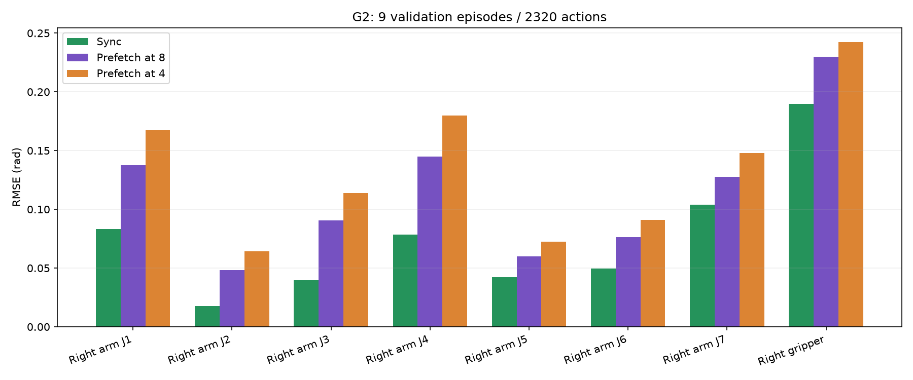
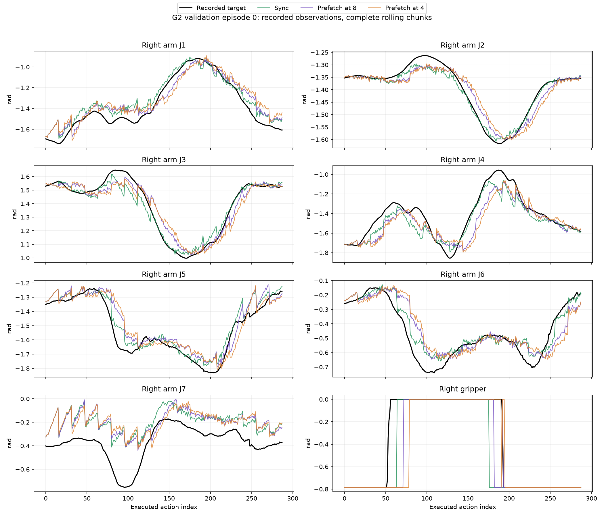

# EVA × StarVLA 完整动作链路与异步部署验证（2026-10-14）

入口：[部署模块](README.md)；真机交接：[G2异步部署文档](G2_ASYNC_DEPLOYMENT.md)。默认G2为H64/C16/K4，第8步预取，当前16步全部发出后接入下一段。无需修改EVA或StarVLA模型核心。

## 结论与实测范围

**本次验证的数据、请求、动作处理及模拟执行链路通过。默认异步存在明确的精度与时序代价，不能称为同步训练条件下完全等价的部署，也不能据此保证G2真机任务成功。** 未发送真实机器人动作。

| 测试 | 结果 |
| --- | --- |
| CPU接口与调度 | **72项通过**；完整chunk、4/8步预取、迟到等待、线程边界、重置、重连、超时、像素/状态、无订阅拒发、原生EVA+ZMQ+Mock GDK |
| G2同步完整链路 | **9条 / 2320命令 / 2320伺服请求 / 149预测chunk**；MSE **0.00275524**；18个预测/目标数组与直接回放及10月13日基线逐元素一致 |
| G2默认8步预取完整链路 | **9条 / 2320命令 / 2320伺服请求**；MSE **0.00536994**；命令、像素、原始状态核对最大差异均为0 |
| G2可选4步预取完整链路 | **9条 / 2320命令 / 2320伺服请求**；MSE **0.00715524**；上述数值核对最大差异均为0 |
| G2目标30Hz独立测时 | 每模式128步；8步预取7个段边界有5次等待，**20.8–85.9ms**；4步预取无边界等待 |
| LIBERO同步闭环 | 55K自蒸馏RollFlow，**3/4成功**；四条动作数组与10月13日基线逐元素一致 |
| LIBERO异步闭环 | 同一55K模型，H32/C8、第4步预取，**3/4成功**；仿真真实执行动作并更新后续观测 |
| LIBERO原生接口核对 | 同一观测序列38个chunk；像素、原始预测、夹爪处理后动作最大差异均为0 |
| G2状态归一化独立核对 | 16个样本；手算static-aware q99与服务端结果最大差异0 |
| EVA源码审计 | 用户原始ZIP的1353个非缓存文件，0缺失、0修改 |

CPU：[日志](validation/20261014/cpu.log.txt)、[JUnit](validation/20261014/cpu.xml)。主要数据：[G2模式汇总](validation/20261014/g2_modes_summary.json)、[同步链路](validation/20261014/g2_wire_servo100.json)、[8步异步链路](validation/20261014/g2_async8.json)、[4步异步链路](validation/20261014/g2_async4.json)、[原生接口核对](validation/20261014/libero_reference.json)、[源码审计](validation/20261014/eva_source_audit.json)。完整产物及源码指纹见 [清单](validation/20261014/artifact_manifest.json)。

## 1. 这次补齐了什么

之前的G2测试停留在EVA动作后处理，没有验证命令是否经过真实消息编码、底层关节顺序和伺服请求。本次同步/异步G2都走：

```text
记录的图像/状态
 → 原生G2相机解码/关节状态拼接/观测编码
 → 本地ZMQ
 → EVA完整观测检查 / 训练一致的图像处理
 → StarVLA实际模型 / 训练归一化 / 反归一化
 → EVA夹爪后处理 / 原生publish_next_action
 → ZMQ动作编码
 → 原生G2动作解码 / JointServoControlReq
 → Mock GDK
```

每条收到的命令和伺服请求都与EVA当前后处理chunk的对应行逐元素核对。动作端点固定为临时私有IPC，真实GDK被显式替换为Mock；不会连接真机。

观测来自外生记录数据，不能模拟命令改变真实机器人状态后的后续相机画面。LIBERO补充了实际执行动作、获取新状态和新图像的仿真闭环；它仍不能替代G2真实驱动验证。

## 2. 已修复或明确的执行问题

| 问题 | 当前处理 |
| --- | --- |
| 准备阶段丢弃验证预测，却保留rolling缓存 | 外部策略reset同时清理EVA计数、transport chunk和模型缓存；warmup不额外推理 |
| 原生固定频率后台策略可能多次预取、裁切迟到动作 | 新增独立 `StarVlaAsyncRollingStrategy`；一次只预取一整段，按实际已发命令计数触发 |
| 提前返回的下一段覆盖当前剩余8步 | 结果只在完整当前16步发完后激活；不能在推理线程发布动作 |
| 网络/后台推理失败后误回落到同步流程 | 保留异步错误状态，控制循环报错停止，不重试或继续推进缓存 |
| 重置/重连期间旧结果混入新回合 | 停止并等待在途请求结束，丢弃旧结果；检查策略连接实例；重连前关闭旧流 |
| 首次冷启动约3秒，被1秒通用限制误拒绝 | G2冷启动单独允许5秒，后续rolling仍限1秒，请求超时5秒；CPU分别验证两种限制 |
| 长推理后读到堆积的旧观测 | 控制与反馈reader只保留最新完整消息，缺相机/状态或超0.5秒无接收/时间戳进展拒发 |
| 无动作订阅仍以为已发布成功 | XPUB检查空主题订阅就绪，无订阅拒发；这不是硬件执行ACK |
| 展示关节名称与GDK名称被混为一谈 | 分别声明可视化outer夹爪与硬件inner夹爪名称；静态检查底层24维顺序 |
| EVA通用G2初始化姿态与此任务差异很大 | 此配方使用100条训练数据首帧中位姿态，排除9条验证数据，供原生初始化流程使用 |
| 日志写入失败造成重试/重复动作 | trace为非致命诊断；已发动作计数不回滚、不重发 |

### ZMQ绑定方向复核

部署统一为“硬件观测PUB绑定 / EVA观测SUB连接；EVA动作XPUB绑定 / 硬件动作SUB连接”，并提供外部 `hardware` 入口。

初步一次连接角色探针没有收到反向拓扑的数据；后续独立复核中，**PUB/XPUB × 两种绑定方向，在私有IPC与本机TCP的8个组合全部能通信**。[复核矩阵](validation/20261014/wire_role_matrix.json)。因此不能将绑定方向或libzmq版本认定为以前真机问题的根因。此修改是明确部署角色、避免两端重复绑定，并检查订阅就绪。之前联调的具体根因仍需要现场输入、命令及GDK反馈trace。

## 3. G2拟合：同步与异步的区别

权重：

```text
/data/tzq/starVLA_checkpoints/agibot_g2_rollingflow_h64_c16_b64_mb4_ga4_scratch_30k_20261010/final_model/pytorch_model.pt
```

纯瞬时速度Flow Matching + Rolling，无MeanFlow/LSD。验证episode：0、13、27、40、54、67、81、94、108。模型H64/C16/K4保持不变。

| 模式 | 全24维MSE | 全24维RMSE/rad | 右臂7关节RMSE/rad | 右夹爪开闭一致率 | 绝对动作向量余弦 |
| --- | --- | --- | --- | --- | --- |
| 同步 | 0.00275524 | 0.05249 | 0.06553 | 94.05% | 0.99811 |
| 第8步预取 | 0.00536994 | 0.07328 | 0.10427 | 91.29% | 0.99639 |
| 第4步预取 | 0.00715524 | 0.08459 | 0.12700 | 90.34% | 0.99527 |

夹爪一致率按处理后开/闭类别统计，软夹爪标签与离散命令的差异亦计入MSE。24维里大量关节不运动，绝对qpos向量还有较大的共同偏置；不能用高余弦值推断动态动作拟合很好。右臂和右夹爪指标更适合判断此任务。

默认8步的请求观测步为0、8、24、40……，预测实际接入动作起点为0、16、32、48……。缓存/动作仍推进16步；观测相对下一段起点提前8步。4步预取则提前12步。本次提前得更多的配方拟合误差更高，不能声称异步与同步训练观测严格等价。

三个模式均在9条回合开始前一次设置seed=7，回合之间清缓存、不重新设置种子。异步在回合末可能已预取未执行的下一段：8步总请求154、4步155，同步149，额外请求会消耗随机数。因此这是实际配方的一次回归比较，不是严格固定每回合随机数路径的因果消融；不能把全部误差差异只归因于观测提前。回合末允许终止当前部分chunk，旧缓存与未用结果随后丢弃。

episode0还存在模型本身的拟合不足：同步模式右臂J7的RMSE为0.202rad、最大误差0.510rad。首次右夹爪打开的目标索引53，同步/8步预取/4步预取分别为64/72/79。链路没有额外改动这些输出，但腕关节误差和夹爪时序可能影响抓取；不能因为整体趋势相似就认为真机任务已可靠。

### 关节轨迹与误差图





完整24关节：[PNG](validation/20261014/g2_episode0_all_joints.png)、[PDF](validation/20261014/g2_episode0_all_joints.pdf)。逐步预测/目标：[同步NPZ](validation/20261014/g2_direct.npz)、[8步NPZ](validation/20261014/g2_async8.npz)、[4步NPZ](validation/20261014/g2_async4.npz)。

### 图像与状态

G2为BGR→RGB一次、Pillow bicubic直接resize至224×224、无填充/旋转；此次训练配方没有额外图像增强。三相机按top_head、hand_left、hand_right排列。状态原始24D发送，服务端复用权重训练变换；动作反归一化后进入EVA夹爪处理。

手算q99检查：宽度≤1e-3的固定维度映射0；其余维度 `2*(x-q01)/(q99-q01)-1`，截断至[-2.2,2.2]。16个trace样本与服务端归一化结果最大差异0。[核对记录](validation/20261014/g2_normalization.json)。

## 4. 时序：默认8步不保证全程无停顿

完整Mock GDK探针有逐条PNG编码、socket轮询和模拟伺服开销；G2 trigger帧在执行前解码。探针的动作间隔比真实目标33.3ms长，所以两种异步模式都未出现段边界等待。这个结果不能证明真机30Hz连续。

另用内存观测/输出、实际模型RPC和原生EVA动作流程，按目标30Hz测试128步，排除ZMQ/GDK/动力学开销：

| 模式 | 动作间隔P50 | P95 | 最大间隔 | 7个段边界等待 |
| --- | --- | --- | --- | --- |
| 第8步预取 | 33.40ms | 33.84ms | 119.46ms | 5次；20.8–85.9ms |
| 第4步预取 | 33.40ms | 33.63ms | 33.80ms | 0次 |

[8步时序原始数据](validation/20261014/g2_timing8.json)、[4步时序原始数据](validation/20261014/g2_timing4.json)。两者均实际发出128个内存命令，原生session计数128；未创建动作socket。每次返回/接入仍是完整16步。

8步在30Hz下仅有267ms推理余量，本次滚动RPC中位数约328ms；4步有400ms余量，约344ms的滚动RPC可覆盖。首次冷启动是单独的等待，不计入段边界等待次数。

**默认按用户确认保留8步预取。** 它的拟合优于4步；仍有短暂停顿。4步是可选的更早预取配方，不能因为连续性更好就忽略精度下降。模型服务器负载、跨机网络、真实相机解码和底层控制都会改变实际余量；需要用现场execution trace复核。

## 5. LIBERO仿真闭环与视频

55K自蒸馏RollFlow权重：

```text
/data/tzq/starVLA_checkpoints/libero_qwengroot_rollflow_h32_c8_b128_unfrozen_463a1f7/checkpoints/steps_55000_pytorch_model.pt
```

每回合重置seed=7。同步完整执行C8后读观测；异步在第4步读取观测并预取，当前C8发完再接。

| Goal任务 / 初始状态 | 同步成功 / 步数 | 异步成功 / 步数 | 异步视频 |
| --- | --- | --- | --- |
| 开中间抽屉 / 0 | 是 / 121 | 是 / 141 | [视频](validation/20261014/videos_async/task_0_episode_0.mp4) |
| 开中间抽屉 / 1 | 是 / 115 | 是 / 128 | [视频](validation/20261014/videos_async/task_0_episode_1.mp4) |
| 碗放炉台 / 0 | 是 / 89 | 是 / 154 | [视频](validation/20261014/videos_async/task_1_episode_0.mp4) |
| 碗放炉台 / 1 | 否 / 300 | 否 / 300 | [视频](validation/20261014/videos_async/task_1_episode_1.mp4) |

[同步JSON](validation/20261014/libero.json)、[异步JSON](validation/20261014/libero_async.json)、[异步执行轨迹](validation/20261014/libero_async.npz)。同步四条动作数组与10月13日基线一致；异步因观测提前，轨迹和步数变化。CPU渲染/物理步耗时较大，不能用此仿真wall time声称能实现实际20Hz。

38个chunk的原生 `ModelClient.step` 核对使用相同观测和同一个StarVLA服务器，验证EVA像素、动作chunk和夹爪处理。它不能独立验证历史服务代码。4次闭环也不是完整benchmark或G2真机成功率。

## 6. 当前还不能证明的部分

1. G2真实SDK读数是否为相同rad单位、符号及内外夹爪定义，真实关节是否按命令正确执行。静态名称和Mock向量核对不能替代反馈。
2. 各相机真实采集时刻是否同步。现有EVA消息只有完整消息时间戳，客户端只验证完整性和接收/时间戳进展。
3. 命令到硬件的执行确认。XPUB只检查订阅就绪；无GDK执行ACK。拒发后底层可能维持最后目标，不是物理急停。
4. 异步旧观测条件在G2实际任务中的成功率。回放是外生观测，不能模拟机器人偏差积累；目前已有误差增加证据。
5. 任意未来EVA/StarVLA版本、新本体或算法自动兼容。升级后需doctor/CPU/固定回放/仿真，接口变化集中调整adapters。

机器人端先用无动作socket的 `capture` 保存真实输入，再用live trace对比模型输入、后处理chunk、已发命令及GDK反馈。部署命令和故障恢复见 [交接文档](G2_ASYNC_DEPLOYMENT.md)。

## 7. 运行记录

- 基准提交 `b44e91844f53997833df95f2d97bd6d361109dc5` 加工作区部署变更；模型目录已有本地MeanFlow诊断改动，本次未编辑这些文件，不宣称干净历史tag复现。
- 所有模型验证在GPU3运行，一次一个服务，PyTorch allocator上限6GiB；源数据只读，G2动作仅私有IPC/Mock GDK，LIBERO为CPU OSMesa仿真。
- 验证完成后本次模型服务/评估tmux会话均退出，原有ResWAM四个训练PID仍运行。CPU接口测试不调用模型或真机。
- 数据JSON里的绝对路径是测试机器路径；迁移时按交接文档配置。二进制产物保存确定的预测/目标和视频，完整输入trace及日志保存在本机 `work_dirs/eva_validation/deployment_20261014/`。
